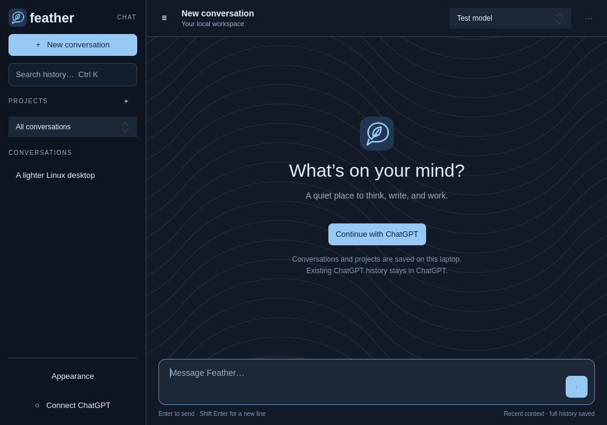
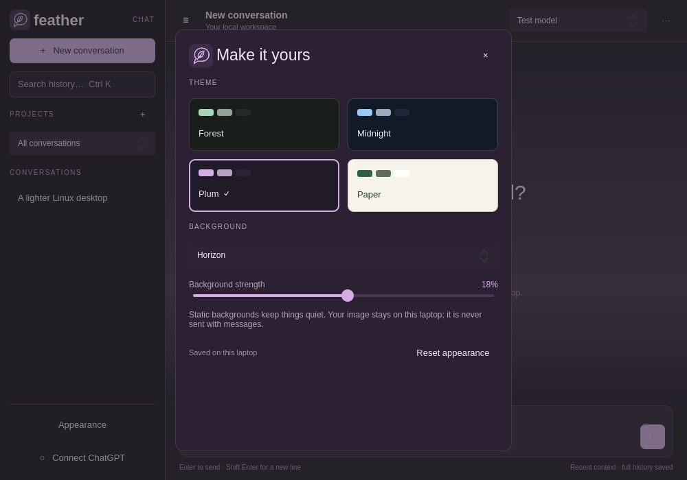

<p></p>

# Feather Chat

A small native chat client for Omarchy, Hyprland and Quickshell. Built for a Pentium Silver N5030 laptop with 4 GB of RAM. Independent software; not an official OpenAI application.



## Install

Requires a Wayland desktop and the packages listed under development requirements. From a source checkout:

```sh
python install.py
```

This installs the app for your user without downloading packages or changing your desktop theme.

## Open the app

Find **Feather Chat** in the application launcher, or run:

```sh
~/.local/bin/feather-chat
```

Choose **Continue with ChatGPT**, finish sign-in and consent in your browser, then return to Feather. An eligible ChatGPT plan and permission to use that plan are required. The model picker is populated from your account's actual available models. You do not need to copy an API key or reuse Codex credentials.

Sign-in is implemented from the current official OpenAI OAuth documentation. Registration, identity validation, refresh and streaming are covered by offline tests. A real user sign-in and model response still need to be verified from the live desktop: this build environment cannot connect to the desktop's Wayland/DBus sockets or OpenAI endpoints. The app reports connection, permission and usage-limit failures instead of pretending a connection succeeded.

**Feather stores its own conversations and projects. It cannot synchronize existing ChatGPT conversations, Projects, memories or custom GPTs.** Its current scope is text chat, local projects/instructions, history search and Markdown export. It does not implement file attachments, voice or ChatGPT's hosted tools.

## Appearance

Open **Appearance** near the bottom of the sidebar, or press **Ctrl Shift ,**.

- Choose **Forest**, **Midnight**, **Plum**, or the light **Paper** theme. All controls and the in-app logo follow the palette.
- Select a solid background, **Contours**, **Graph paper**, or **Horizon**.
- Choose your own PNG, JPEG, WebP or SVG. Images are read from their local location and are never attached to messages or uploaded.
- Adjust the background strength and choose whether a photo fills the area or is shown whole. Messages retain a readable surface over backgrounds.
- Preferences save automatically and survive restarts. **Reset appearance** restores the defaults without touching conversations or account settings.

Custom images must be smaller than 50 MB. Images are loaded asynchronously with a requested display size capped at 1600×1000; patterns use a small tile. Moving or deleting a selected image leaves the theme usable; choose a replacement or another background. Backgrounds are static, with no blur, animation or timers.



## Features

- Streamed text, selectable Markdown replies, copy and stop.
- Local SQLite history with full-text search and pagination.
- Project folders with saved instructions; move and rename conversations.
- Markdown export and explicit confirmation before deleting a conversation.
- Browser-based ChatGPT sign-in with PKCE, state and nonce checks, RSA signature verification, multiple account registrations, token renewal and sign-out.
- Keyboard shortcuts: **Ctrl N** new conversation, **Ctrl K** history search, **Ctrl B** sidebar, **Ctrl ,** account, **Esc** stop reply, **Ctrl Q** quit. **Enter** sends, **Shift Enter** inserts a new line.
- Reopening the launcher focuses the existing instance. Closing the last window quits the app and its backend. Nothing autostarts.

History is a local laptop workspace shared across your saved account registrations. Switching the connected account changes who handles future requests; it does not hide local history. Recent completed messages (at most 32 messages / 48,000 characters), plus project instructions, are sent with each request. All older messages remain available locally. Interrupted/stopped assistant replies are saved but excluded from future context.

## Performance choices

Quickshell/QtQuick renders the interface directly, without Chromium, Electron, a webview, JavaScript server or a Python GUI dependency. The backend uses Python's standard library and the existing system OpenSSL. Network requests run in workers; SQLite stays in a separate process from the interface.

Message delegates are recycled; only 40 messages and 60 history rows load initially. Search waits for 180 ms of typing inactivity. Streaming is batched to about 15 updates per second, with plain-text rendering until a reply completes. Database writes are checkpointed at two-second intervals while streaming. File watching and the composer cursor's blink are disabled; there are no app animations, polling or idle timers. Production uses Qt's normal hardware renderer on Wayland, not the offscreen software renderer used by tests.

Measured in the restricted build environment with a warm filesystem cache, offscreen software rendering, 5,000 conversations and 20,000 messages:

| Measurement | Result |
|---|---:|
| UI and backend ready, excluding launcher | 540 ms |
| Combined idle resident memory | 114.2 MiB |
| Idle CPU, two-second sample, one-core basis | 0.0% |
| History listing, median of 30 calls | 0.22 ms |
| Broad full-text history search, median of 30 calls | 42.46 ms |

These are development measurements, not a guarantee for a live Wayland session, cold startup, every conversation size or server response latency. See [raw benchmark](previews/benchmark.json). Network and model processing determine how quickly replies arrive.

## Files and privacy

Defaults (respecting `XDG_DATA_HOME`):

- `~/.local/share/feather-chat/app/`: installed code and icon.
- `~/.local/share/feather-chat/history.sqlite3`: conversations, projects and search index.
- `~/.local/share/feather-chat/preferences.json`: saved theme, background and local image location.
- `~/.local/share/feather-chat/accounts.json`: account registrations, stable host identifier and tokens.
- `~/.local/share/feather-chat/exports/`: Markdown exports.
- `~/.local/bin/feather-chat`: launcher.
- `~/.local/share/applications/feather-chat.desktop`: application-menu entry.

The data directory is restricted to your user (0700); credential files are atomically written with mode 0600. Tokens are **not encrypted at rest**. Your OS account and disk encryption protect local data. Tokens never enter QML, application logs or conversation storage. Authorization URLs can carry the OpenAI ID-token hint and are passed only to the browser, never logged by Feather. Requests go to the documented public Responses API with `store:false`; this does not mean OpenAI has no service-side retention policies.

Sign-out attempts to revoke the refresh session, clears local tokens and retains the client/identity mapping and host identifier for a later sign-in. If revocation cannot be confirmed, the app tells you to disconnect it in ChatGPT Settings. Sign-out keeps local conversation history.

## Develop, verify and reinstall

Requirements already present on the target laptop: Quickshell 0.3.1+, Python 3 with SQLite FTS5, OpenSSL, `xdg-open`, QtQuick Controls Basic, Qt Quick Dialogs, Qt SVG, and Wayland. `hyprctl` is used only to focus an existing app window. There are no package downloads or root-level changes.

From this directory:

```sh
python -m unittest discover -s tests -v
python tests/ui_smoke.py
python tests/benchmark.py
python install.py
```

The UI smoke test runs real Quickshell offscreen with isolated temporary data, exercises service initialization, projects, search, history loading, simulated stream rendering, draft preservation, all four themes, local backgrounds, the image-picker callback and preference reset, and writes screenshots to `previews/`. In a socket-restricted environment, Quickshell's IPC-server warning is expected; it does not prevent offscreen interface tests. Real single-instance activation and live Wayland rendering require a desktop session.

To run source directly from a desktop terminal:

```sh
QT_QUICK_CONTROLS_STYLE=Basic QT_QPA_PLATFORMTHEME=generic qs -p src
```

Set `FEATHER_DATA_DIR` for an isolated development database. Do not run development and installed instances against the same credentials at the same time: refreshing one OAuth session must be serialized.

## GitHub publishing

The requested destination is the public **thediamondsaint/feather-chat** repository. The local repository excludes credentials, preferences, history, exports and personal screenshots. Preview images use synthetic test conversations.

To create the public repository and push the reviewed commit from a terminal with GitHub access:

```sh
./scripts/publish-github.sh
```

The script checks the signed-in account and origin URL. It does not force-push or change an existing private repository's visibility. If `gh` needs authentication, run `gh auth login` first.

## Uninstall

Close Feather and remove its launcher, desktop entry, icon and `~/.local/share/feather-chat/app/`. Keep the rest of `~/.local/share/feather-chat/` to preserve history, or back it up before removing it. Disconnect the registration in ChatGPT Settings to revoke its remote access.

## Official integration references

- [Registration and sign-in](https://developers.openai.com/siwc/token-sharing-open-source/sign-in)
- [Accounts and sessions](https://developers.openai.com/siwc/token-sharing-open-source/profiles-and-sessions)
- [Models and inference](https://developers.openai.com/siwc/token-sharing-open-source/models-and-inference)
- [Preview limitations](https://developers.openai.com/siwc/token-sharing-open-source/preview-limitations)

The sign-in flow grants eligible model requests, not access to existing ChatGPT conversation history. It currently requires `store:false`, streamed responses and explicit history in each request; unsupported fields such as `max_output_tokens` are omitted.
